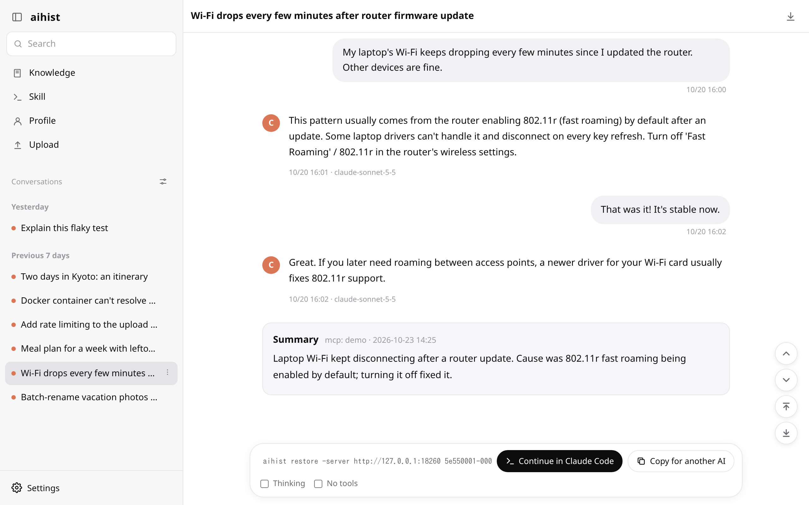
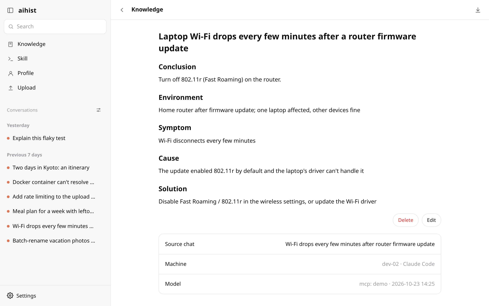
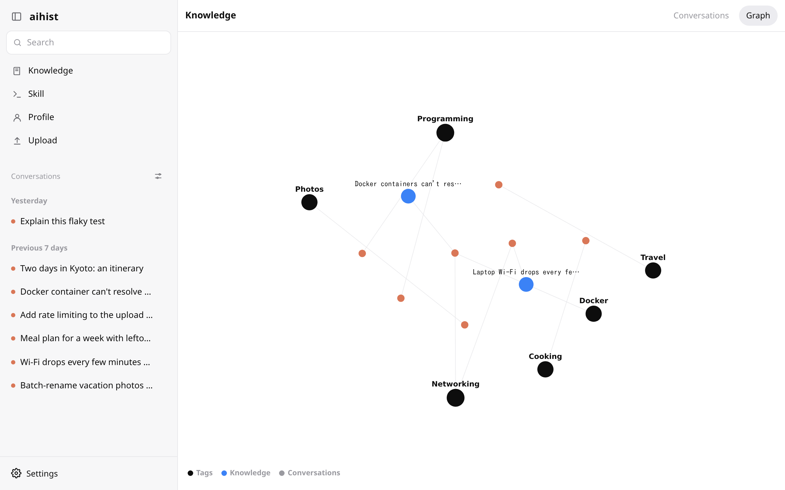
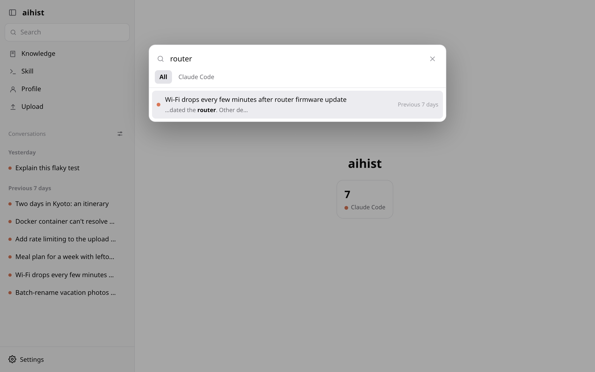
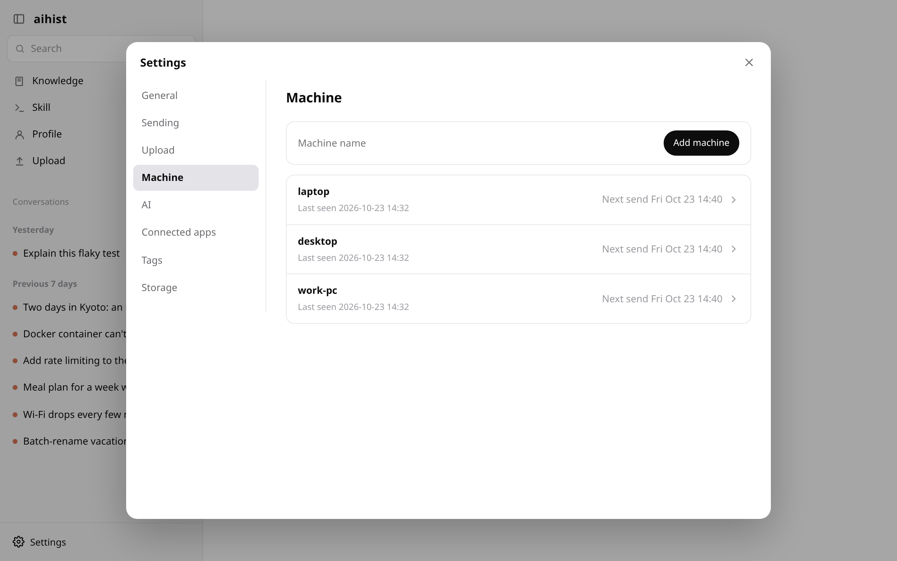

<div align="center">


# aihist

**Every conversation you've had with AI, in one place you own.**

A self-hosted server that collects chats from Claude Code, Codex, OpenCode, ChatGPT and more, so you can search them, read them again, and pick up where you left off.

[](https://github.com/rurutheGeek/aihist/releases/latest)
[](https://github.com/rurutheGeek/aihist/actions/workflows/test.yml)
[](LICENSE)

[**⬇ Download**](https://github.com/rurutheGeek/aihist/releases/latest) · [Install](#install) · [Usage details](docs/usage.en.md) · [日本語](README.md)



</div>

## Features

- **Collect** — A small client on each machine sends your AI chats automatically. Upload ChatGPT, claude.ai and Gemini exports from the UI.
- **Search** — Full-text search across everything, filtered by AI, machine, project, date or tag.
- **Continue** — Put a chat back into the AI it came from and keep talking (`aihist restore`), or export it as Markdown for another AI.
- **Organize** — With any OpenAI-compatible API or over MCP, add tags, summaries, and "Knowledge" articles that would help others too.
- **Protect** — Tokens and passwords are removed on the machine before sending. Old local chats can be deleted once the server has them.
- **Yours** — Data lives in SQLite and the original files on your own server. Nothing goes to a third party.

| Tool | How |
|---|---|
| Claude Code | Automatic (including subagents) |
| Codex | Automatic |
| OpenCode | Automatic |
| Antigravity | Automatic |
| ChatGPT, claude.ai | Upload the export zip |
| Gemini | Upload the Google Takeout zip |

<table>
<tr>
<td></td>
<td></td>
</tr>
<tr>
<td></td>
<td></td>
</tr>
</table>

## Install

### Docker (recommended)

```bash
curl -fsSLO https://raw.githubusercontent.com/rurutheGeek/aihist/main/compose.yaml
docker compose up -d
```

Open http://localhost:8080. The image is `ghcr.io/ruruthegeek/aihist` (linux/amd64, arm64); data lives in `/data`.

### Binary

Download the file for your OS from [Releases](https://github.com/rurutheGeek/aihist/releases/latest) (Linux, macOS, Windows).

```bash
chmod +x aihist-linux-amd64
./aihist-linux-amd64 serve -addr :8080
```

### From source

```bash
git clone https://github.com/rurutheGeek/aihist && cd aihist
go build -o bin/aihist ./cmd/aihist
```

### Connect the machines you chat on

In **Settings → Machines**, enter a machine name to get a one-line command for that machine. It then sends on the schedule you choose. See [Usage details](docs/usage.en.md).

## Updating

When a new version is out, a notice appears at the bottom left (turn it off in **Settings → General**).

| Installed with | How to update |
|---|---|
| Docker | `docker compose pull && docker compose up -d` |
| Binary | `aihist update`, then restart (verified against SHA256SUMS before replacing) |
| Client on each machine | Update the server; clients replace themselves on their next send |

## Login (optional)

With nothing configured, there is no login (for use on your own PC). To use it from elsewhere, sign in with OIDC (Google, Microsoft Entra ID, Keycloak, Authentik, …).

| Variable | Meaning |
|---|---|
| `AIHIST_OIDC_ISSUER` | Issuer URL. Setting it turns login on |
| `AIHIST_OIDC_CLIENT_ID`, `AIHIST_OIDC_CLIENT_SECRET` | The client registered at your IdP |
| `AIHIST_OIDC_REDIRECT_URL` | Callback; register `https://<server>/auth/callback` at the IdP too |
| `AIHIST_OIDC_ALLOW` | Email addresses or `@domain`s allowed to sign in (comma-separated). Empty means anyone |
| `AIHIST_OIDC_GROUPS` | Groups allowed to sign in (`groups` claim) |

Sending from machines and MCP (`/api/*`) are protected by tokens, not by login. The UI never loads images or scripts from other sites and can't be framed by them.

## Contributing

Issues and pull requests are welcome — bug reports, support for another AI tool, translations, docs fixes, anything. See [CONTRIBUTING.md](CONTRIBUTING.md) to get started.

## License

[MIT](LICENSE)
